# Mooketsi Vincent Magwaza

### Full-stack engineer building useful products and the systems that keep them running

I turn early ideas into working software: the interface, API, data model,
authentication, documentation, deployment path, and operational tooling. I care
about products that solve real problems, especially where local knowledge or
everyday workflows have not yet been made easy to use.

Based in **Gaborone, Botswana**. Open to backend, full-stack, and platform-focused
opportunities.

[Portfolio](https://mooketsimagwaza.github.io/portfolio/) ·
[Project CV (PDF)](https://mooketsimagwaza.github.io/portfolio/Mooketsi-Magwaza-CV.pdf) ·
[Email me](mailto:mooketsimagwazajr@gmail.com) ·
[View my repositories](https://github.com/MooketsiMagwaza?tab=repositories)

---

## What I build

- **Product systems** — web and mobile experiences designed around a real user
  journey, not a collection of disconnected screens.
- **Backend and data platforms** — domain-focused APIs, spatial data, queues,
  caching, authentication, and databases with explicit ownership.
- **Production foundations** — observability, rate limits, security boundaries,
  recovery documentation, and deployment workflows that make a system operable.

### Experience and searchable keywords

`Full-stack engineering` · `backend engineering` · `platform engineering` ·
`product engineering` · `system design` · `REST APIs` · `offline-first` ·
`local-first` · `geospatial systems` · `inventory management` ·
`expiry tracking` · `spreadsheet import/export` · `QR and barcode scanning` ·
`authentication and authorization` · `data integrity` · `observability` ·
`CI/CD` · `backup and recovery`

**Languages and frameworks:** TypeScript, JavaScript, React, Next.js, Vite,
Rust, Axum, Python, FastAPI, SQL, Go and Java. **Data and infrastructure:**
PostgreSQL, PostGIS, Redis, SQLAlchemy, sqlx, Alembic, Docker, nginx, GitHub
Actions, OpenTelemetry, Prometheus, Grafana, Tempo, MapLibre, PMTiles and
IndexedDB.

## Selected work

### [Kori — an offline-first safari and wildlife app for Botswana](https://github.com/MooketsiMagwaza/kori)

<table>
  <tr>
    <td colspan="2">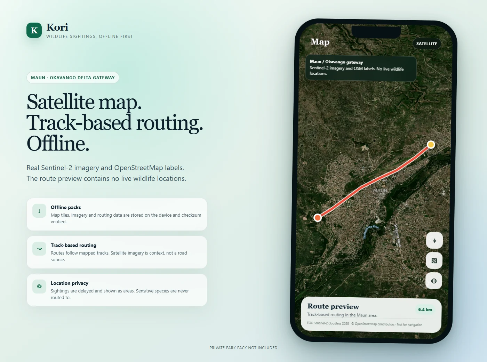</td>
  </tr>
  <tr>
    <td width="50%">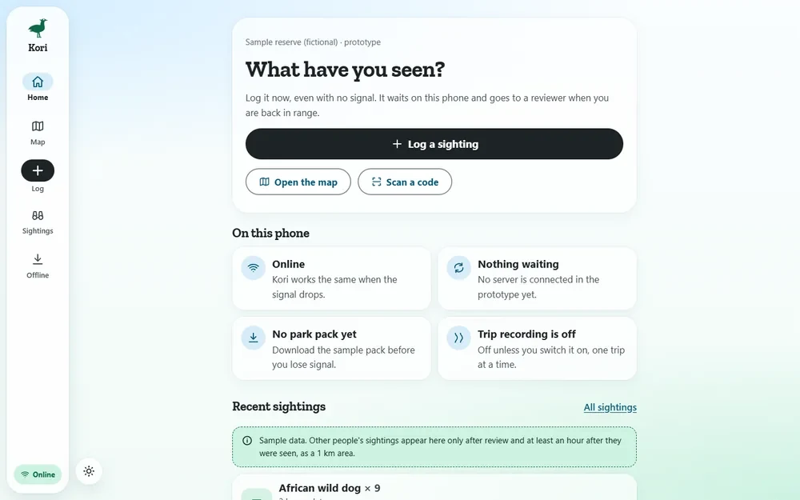</td>
    <td width="50%">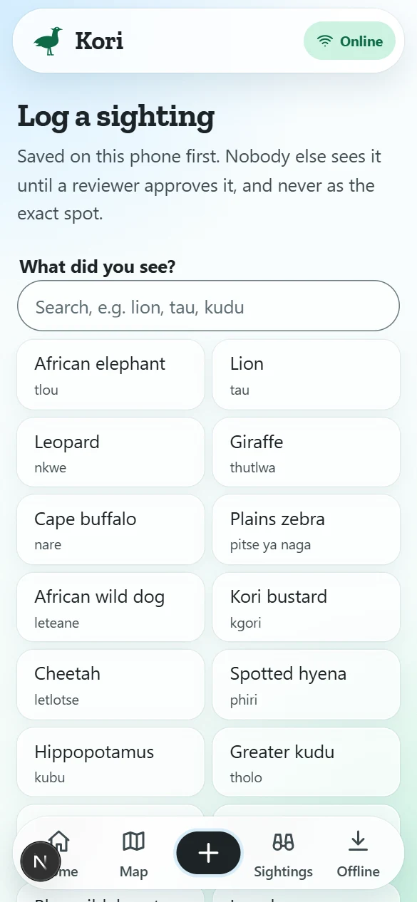</td>
  </tr>
</table>

Kori addresses two Botswana-specific constraints that ordinary map and social apps
handle poorly: safari routes lose mobile coverage, and publishing an animal's exact live
location can be unsafe. It records a sighting offline, keeps it on the phone until a
connection returns, and separates a private observation from the delayed, coarse area
that may safely be shared. The public map visual above uses real Sentinel-2 and
OpenStreetMap context over Maun at the Okavango Delta gateway and contains no live wildlife locations; the private
Savuti pack and its screenshots remain off the web while the relevant wildlife authority
is consulted.

- **Safety and privacy by design.** No live animal locations: others see a sighting only
  after review and a delay, as an area. Sensitive species are shown coarsely and are
  never guided to. GPS trip recording is opt-in per trip, trimmed, delayed, and deletable.
- **Four web apps.** A phone-first field app (an IndexedDB outbox, a downloaded park pack
  drawn locally from PMTiles with MapLibre, routing along tracks only, QR share and scan), a
  landing site, a review console, and an API docs site generated from the service's
  OpenAPI document.
- **A real offline map, privately verified.** The Savuti pack combines an OpenStreetMap
  vector base and routing graph with Sentinel-2 satellite imagery. Its satellite-first
  view, OSM-track routing, attribution, pack storage, and offline reload passed 16 of 16
  automated checks. The pack and its screenshots are not published.
- **A real backend.** A Python service with accounts, scoped API keys and quotas,
  throttling, an audit log, uploads, a review flow, trips and a track map, and 13 database
  migrations on PostGIS. It has 93 passing tests and runs in CI against a PostGIS service.
  The apps do not call it yet, so the data in them stays on the device.
- **Operations included.** Backups, a standby and a restore drill, monitoring
  dashboards, tracing, and a Trivy and dependency-audit workflow.

| Layer | What it uses |
| --- | --- |
| Front end | Next.js 16, React 19, TypeScript, MapLibre, IndexedDB, jsQR |
| API | Python 3.12, FastAPI, SQLAlchemy 2, GeoAlchemy2, Alembic, a scheduler |
| Auth and files | GoTrue (an open-source auth server), MinIO object storage |
| Data | PostgreSQL 16 with PostGIS, a standby, scheduled backups, a restore drill |
| Observability | OpenTelemetry, Prometheus, Grafana, Tempo, a Postgres exporter |
| Delivery | Docker Compose, GitHub Actions, Trivy, Dependabot |

### [Tagwise — a shared register for an organisation's assets and stock](https://github.com/MooketsiMagwaza/tagwise)

<table>
  <tr>
    <td width="50%">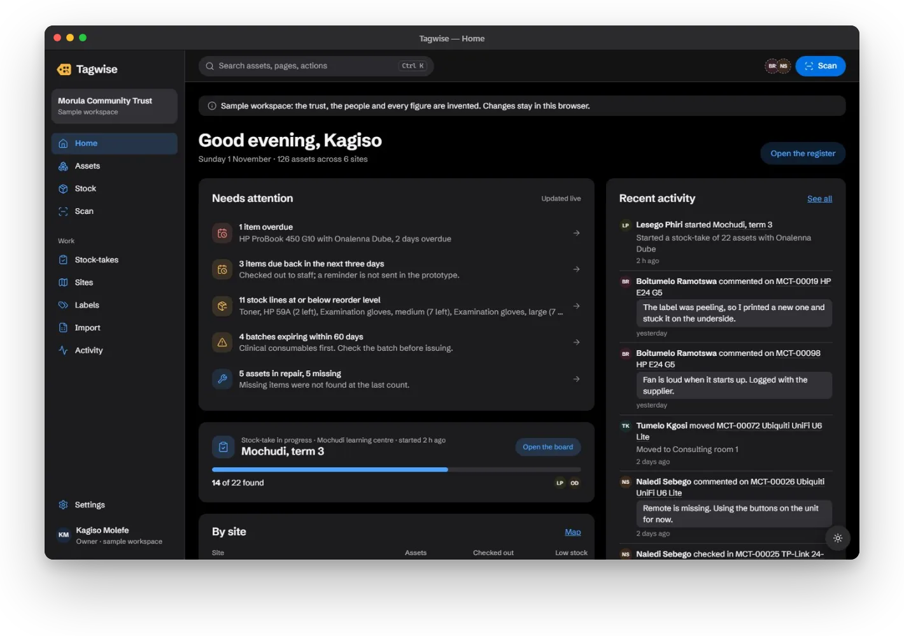</td>
    <td width="50%">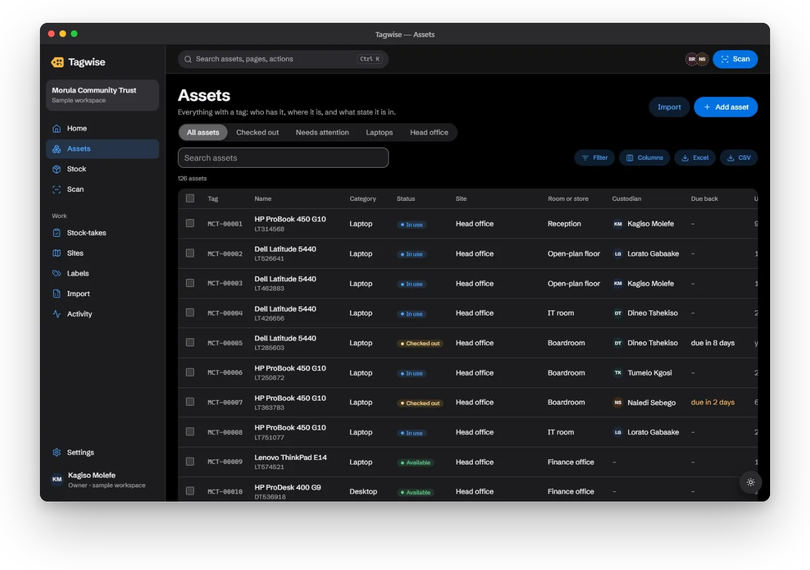</td>
  </tr>
  <tr>
    <td width="50%">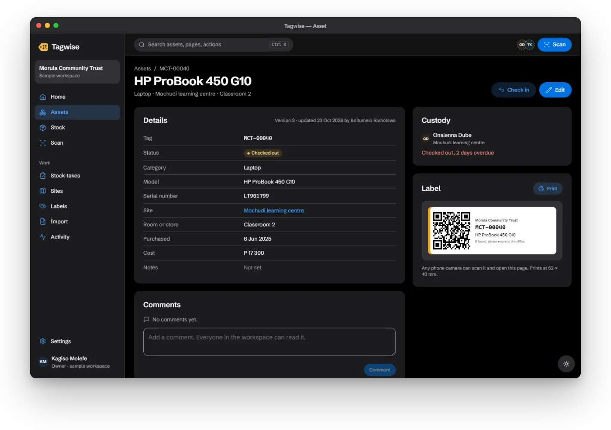</td>
    <td width="50%">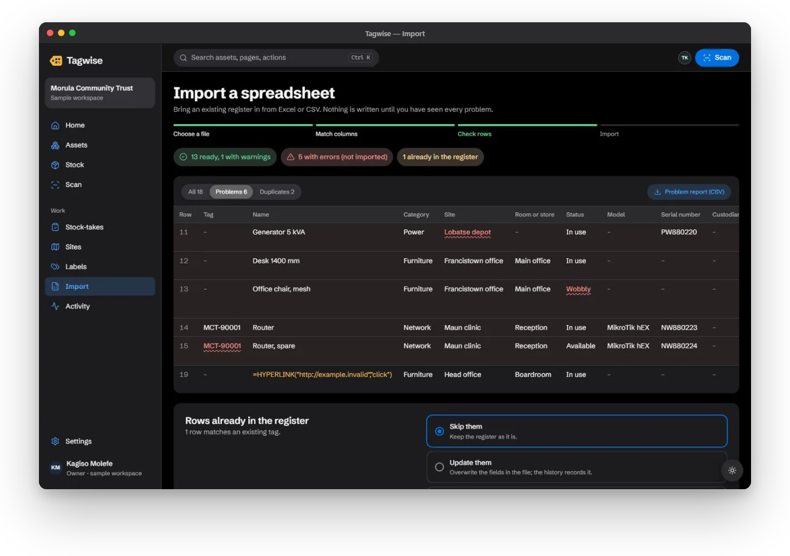</td>
  </tr>
  <tr>
    <td colspan="2">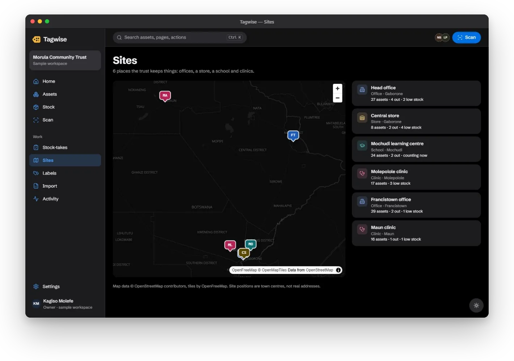</td>
  </tr>
</table>

Tagwise started when my sister needed a practical way to track pharmacy expiry dates,
batches and bulk stock without paying for a desktop point-of-sale subscription plus
separate extensions. It keeps the familiar Excel-like table and import/export workflow,
then adds expiry alerts, QR and barcode scanning, printable labels, stock history,
multi-person stock-takes, roles and site maps. It runs in the browser rather than requiring
a dedicated desktop client. The long-term goal is an open-source alternative, but the
public repository is still all rights reserved until a licence is selected. The
organisation shown in the product is a fictional sample.

- **A flat Apple-style interface.** System-like surfaces, grouped lists, hairline borders,
  one accent, and no decorative gradients keep the data-dense workspace calm on desktop
  and phone.
- **The register.** Saved views, filters and sorting, asset and stock pages with check-out,
  issue and receive, comments, history, and roles; edits made from an out-of-date copy open
  a conflict dialog instead of overwriting.
- **Scan and label.** Camera scanning with a manual-entry fallback, and printable QR label
  sheets.
- **Import and export.** An Excel and CSV import wizard that matches columns, checks every
  row, handles duplicates, and writes a problem report.
- **Expiry and batch control.** Stock lines store batch and expiry dates; the register
  highlights near-expiry and expired dates, the dashboard calls out expiring batches, and
  a saved view isolates stock approaching expiry.
- **Stock-takes** several people can run at once, and a map of sites.
- **Five Rust services.** Identity, register, notifications, media, and ops, each with its
  own database and migrations, behind an nginx gateway. The register service's database
  tests (concurrent issues never take stock below zero, retries are idempotent, workspaces
  are isolated) run in CI on PostgreSQL, and a smoke test signs in by one-time code and
  checks that another account is refused. The app runs on a sample workspace in the browser
  and does not call the services yet.

| Layer | What it uses |
| --- | --- |
| Front end | React 18, TypeScript, Vite, MapLibre, ZXing, SheetJS |
| Services | Rust, Axum, tower; identity, register, notifications, media, ops |
| Gateway and runtime | nginx, Docker Compose |
| Data | PostgreSQL (a database per service), Redis |
| Observability | OpenTelemetry, Prometheus, Grafana, Tempo; a request ID in every log line |
| Docs | Fumadocs, with an OpenAPI reference generated from the services |
| Delivery | GitHub Actions (lint, type-check, tests, build, compose validation, database tests), Dependabot |

### [Opaline — an acrylic launcher for Windows](https://github.com/MooketsiMagwaza/opaline)

<table>
  <tr>
    <td width="50%">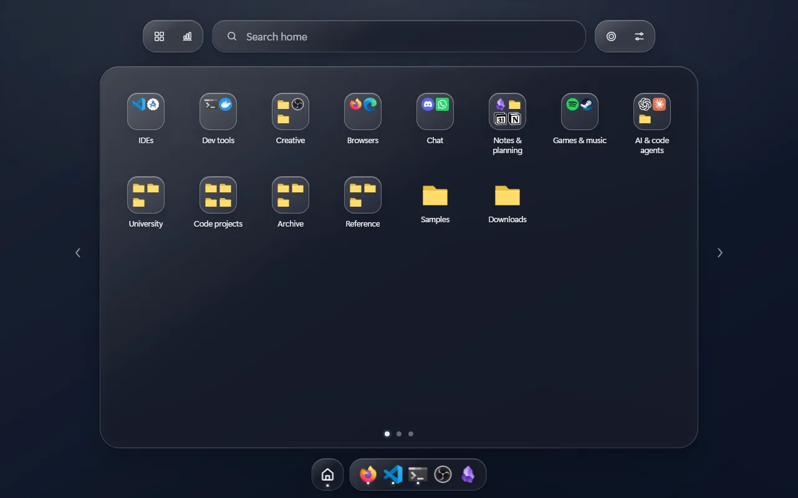</td>
    <td width="50%">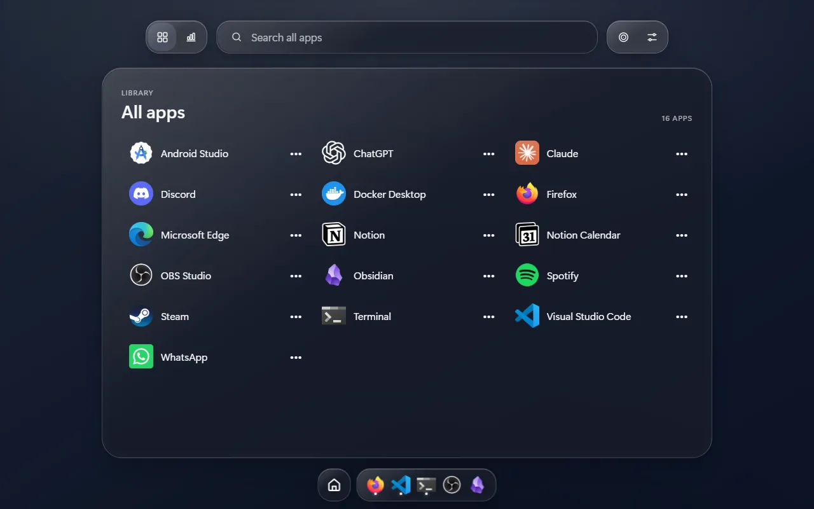</td>
  </tr>
  <tr>
    <td width="50%">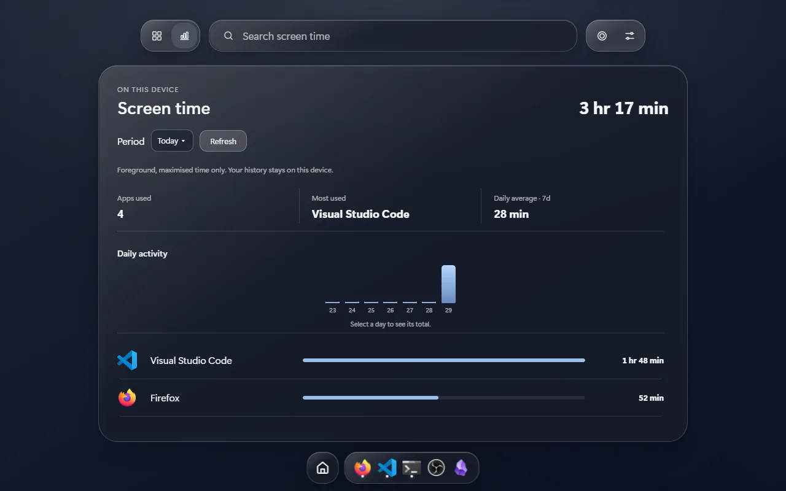</td>
    <td width="50%">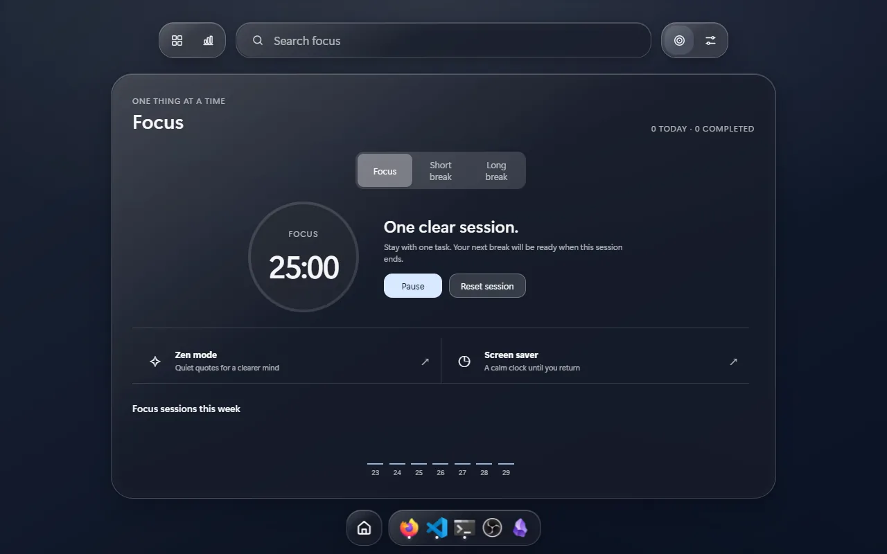</td>
  </tr>
</table>

Opaline makes a crowded Windows desktop easier to use without moving the files on it or
replacing the Windows shell. A hotkey opens a full-screen acrylic layer with virtual
panes, searchable installed apps, custom home screens, a taskbar mirror, local screen-time
totals and focus tools.

- **Safe file boundary.** Opaline reads the Desktop but never moves, renames or deletes
  its files. It makes no network requests.
- **Native Windows integration.** Tauri 2 and Rust handle the global hotkey, window
  lifecycle, app catalogue, icons, taskbar state, previews and local persistence.
- **Plain web interface.** Framework-free TypeScript and CSS render the acrylic launcher,
  search, panes, settings, screen-time charts and focus views through WebView2.
- **Local data.** Pane metadata, custom screens, settings and usage totals stay on the
  computer. Window previews stay in memory.
- **Published Windows builds.** Release v0.2.1 is available as NSIS, MSI and portable
  packages. Remaining physical Windows checks are listed in the repository work order.

| Layer | What it uses |
| --- | --- |
| Interface | TypeScript, CSS, WebView2 |
| Native backend | Tauri 2, Rust, Windows APIs |
| Local storage | JSON metadata and WebView local storage |
| Verification | Vitest, Rust unit tests, documented Windows acceptance checks |
| Delivery | NSIS, MSI, portable ZIP, SHA-256 checksums |

### [University CS Docs — an open learning platform](https://university-cs-docs.vercel.app)

<table>
  <tr>
    <td width="50%">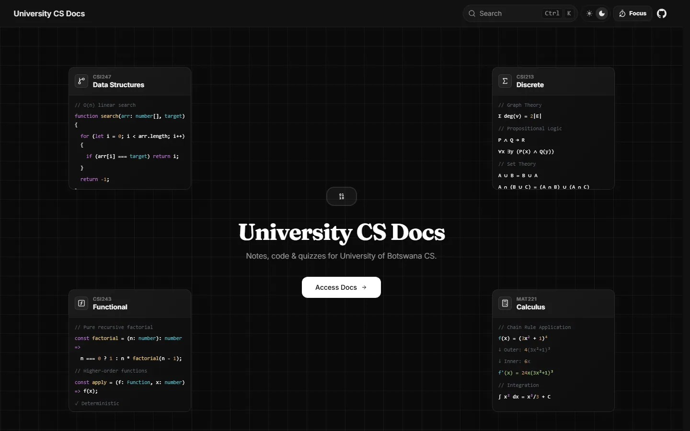</td>
    <td width="50%">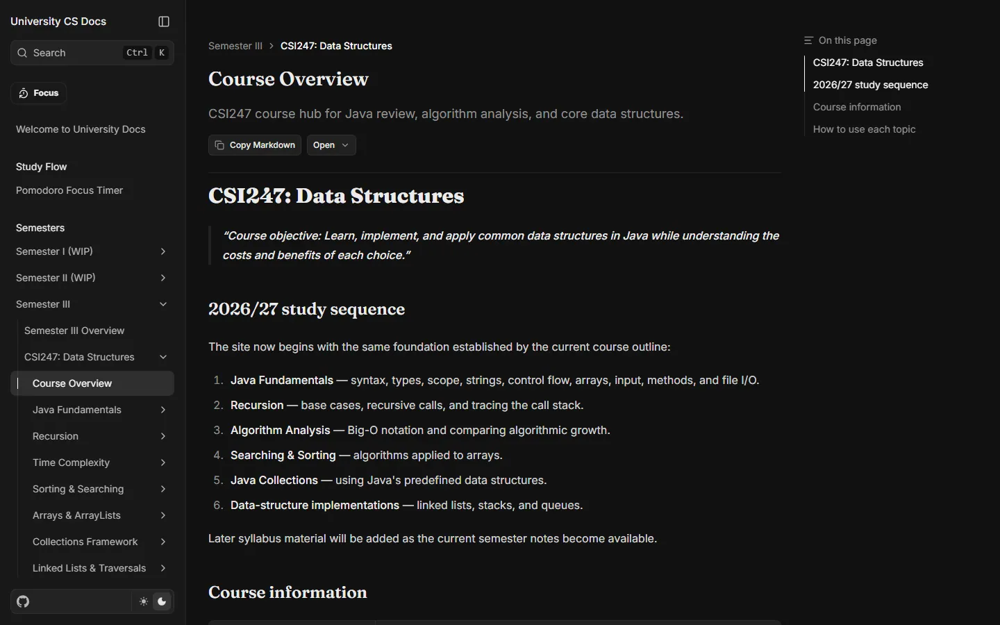</td>
  </tr>
  <tr>
    <td width="50%">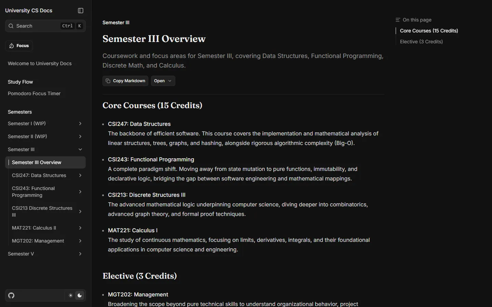</td>
    <td width="50%">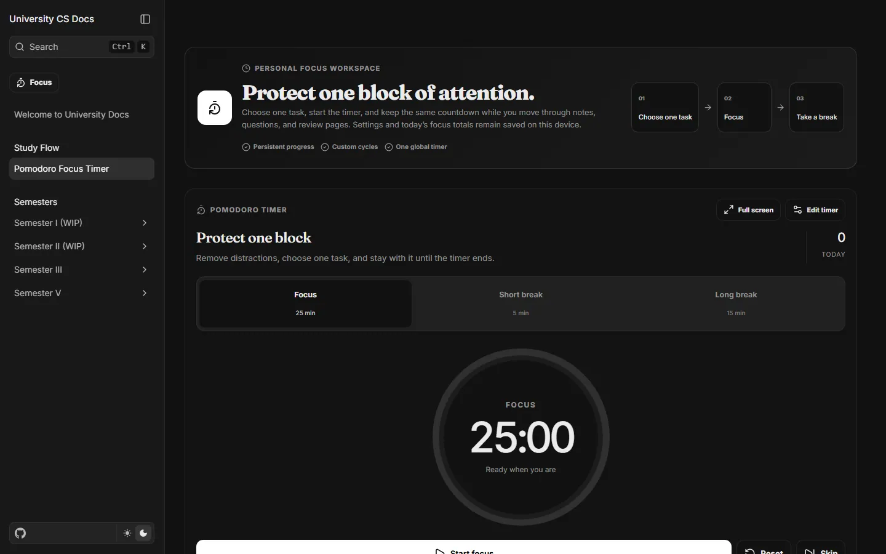</td>
  </tr>
</table>

University CS Docs puts course notes, code, quizzes and study tools for University of
Botswana computer-science students in one deployed site. Course material is built from
reusable MDX components so contributors can add content without rebuilding the platform.

- Next.js and MDX course pages, semester views, quizzes and a focus timer.
- Public contribution guidance and project governance alongside the course material.
- GitHub Actions, CodeQL and dependency review on changes.
- Open-source repository: [MooketsiMagwaza/university-cs-docs](https://github.com/MooketsiMagwaza/university-cs-docs).

## Technical toolkit

| Area | Tools I use |
| --- | --- |
| Backend | Rust, Axum, Python, FastAPI, Go, Java, REST APIs |
| Web | TypeScript, React, Next.js, Vite, accessible responsive UI |
| Data | PostgreSQL, PostGIS, pgRouting, Redis, SQLAlchemy, sqlx, Alembic |
| Operations | Docker, nginx, GitHub Actions, Prometheus, Grafana, Tempo, OpenTelemetry |
| Native | Tauri 2, Rust, Windows APIs, WebView2 |

## How I work

1. Start with the user journey and the facts the system must preserve.
2. Give data and service boundaries explicit owners.
3. Treat authentication, validation, rate limits, and failure states as product
   work—not a cleanup phase.
4. Document what is working, what is scaffolded, and what evidence is still
   needed before launch.
5. Prefer a small, understandable system until measured load justifies more
   infrastructure.

## Let's talk

I am interested in teams that care about product thinking, dependable backend
systems, and engineers who can work across boundaries. I am especially happy to
walk through the decisions, trade-offs, and unfinished edges in any project
above.

**[mooketsimagwazajr@gmail.com](mailto:mooketsimagwazajr@gmail.com)**
